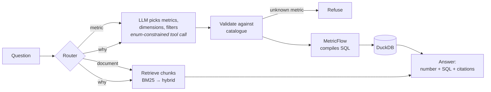

# Tickmark

*`finance-tickmark`: an auditor's tickmark says a figure was checked against its source. This puts one on every answer.*

Ask a finance question in plain English, get a governed answer: **a number from the semantic layer, the SQL that produced it, and a cited source for the explanation**, with every change gated by evals in CI.

> **The LLM never invents a metric.** It can only select metrics and dimensions from a dbt semantic layer, and every answer is scored against a golden set.

```
Q: Why is Q3 opex over budget?

A: Q3 opex was £5.63m against a budget of £5.33m, £305k over.
   Most of it is Engineering contractors (+£264k): the data-centre exit was
   brought forward from FY2027 after the colocation provider gave notice, and
   the CTO approved the contractor ramp in June. [notes/engineering_q3_migration.md]
   Customer Operations is £56k under on opex, due to the July hiring freeze. [commentary/2026-07.md]

   SQL ▸  SELECT ... FROM fct_pnl ... (generated by MetricFlow)
```
*(Target output; the full pipeline lands in week 2–3. See [Status](#status).)*

## Why this exists

In most finance teams, metric logic is scattered across BI workbooks and spreadsheets, so two reports can disagree on "opex". Pointing an LLM at raw tables makes that worse: now a model is improvising SQL too.

This project puts the LLM behind a **semantic layer**. Metrics such as revenue, opex, EBITDA and variance are defined once in dbt, each with an owner and a definition. The model's only job is to pick from that catalogue. If the metric doesn't exist, it refuses.

## How it works



| Layer | What | Where |
|---|---|---|
| Data | Synthetic GL for a fictional SaaS company (2 entities, 5 cost centres, GBP/USD), FY2026 budget, actuals Jan–Sep | `data_gen/`, `dbt/seeds/` |
| Model | Staging → `fct_pnl` in GBP at actual, budget and constant-currency rates | `dbt/models/` |
| Semantic layer | 22 governed metrics with owners and definitions; variances compare closed months only | `dbt/models/marts/metrics.yml` |
| Text-to-semantic-query | Tool schema generated from the catalogue, metric names as enums; structured filters rendered server-side | `app/llm.py`, `app/semantic/` |
| RAG | Heading-aware chunking, BM25 baseline, citations per chunk | `app/rag/` |
| Evals | Generic runner + finance scorers; CI fails below threshold | `evals/` |

### The dataset has planted stories

The documents describe the same fictional company as the numbers, so a "why" question has a real answer that needs both sources:

| Story | In the numbers | In the documents |
|---|---|---|
| S1 | Engineering contractors 2.5× budget in Q3 | Platform migration brought forward; CTO approval |
| S2 | Marketing programmes −45% in Q2, +90% in September | Customer summit moved from June to September (timing) |
| S3 | US revenue −£155k vs budget in Q3 | Dollar weakened; on plan in constant currency |
| S4 | Customer Operations under budget in Q3 | Hiring freeze, four roles vacant |

Ground truth is generated to `corpus/stories.yaml`.

## Evals

Two systems run against the same golden set (`evals/golden/finance.yaml`):

- **`oracle`** runs each case's reference query and retrieval with no LLM. It tests the substrate: if the oracle fails, the data or semantic layer is wrong and no prompt can fix it. Runs on every push.
- **`pipeline`** is the real system, question in and answer out. Runs on pull requests when an API key is configured.

Expected numbers are computed independently from the generator's own arithmetic, never from dbt or MetricFlow output, so the semantic layer is genuinely under test.

| Scorer | What it checks | Gate |
|---|---|---|
| `numeric_accuracy` | Expected numbers within 0.5% | ≥ 0.95 |
| `citation_recall` | Expected sources cited | ≥ 0.80 |
| `refusal_correctness` | Refused exactly when it should (unknown metric, unclosed month, raw SQL) | 1.00 |

Current oracle run (15 cases):

| metric | mean | n |
|---|---|---|
| citation_recall | 1.00 | 5 |
| numeric_accuracy | 1.00 | 9 |
| refusal_correctness | 1.00 | 15 |

The runner (`evals/core.py`) knows nothing about finance: a system is any `case -> output` callable and scorers are plain functions, so it can score other LLM systems unchanged.

## Quickstart

```bash
python -m venv .venv && source .venv/bin/activate
make setup     # pip install -e ".[dev]"
make all       # generate data → dbt build → validate semantic layer → tests → oracle evals
```

Query the semantic layer directly:

```bash
cd dbt && DBT_PROFILES_DIR=. mf query --metrics opex,opex_budget_to_date,opex_variance \
  --group-by cost_centre__cost_centre_name \
  --where "{{ TimeDimension('metric_time', 'quarter') }} = '2026-07-01'"
```

## Design decisions

- **Text-to-semantic-query, not text-to-SQL.** The model emits a structured query; MetricFlow writes the SQL. That removes join and aggregation mistakes entirely, and the SQL is still shown for audit.
- **Enums in the tool schema.** Metric and dimension names are JSON-schema enums generated from the manifest, so the model can't name a metric that doesn't exist. Validation still runs server-side.
- **Variances only over closed months.** `*_budget_to_date` uses budget for months with actuals, so a September YTD variance never compares against October–December budget.
- **Fictional company end to end.** Real filings can't explain a synthetic ledger's variances, so the corpus is generated with the data.
- **BM25 before vectors.** A dependency-free baseline first, so adding embeddings has to beat a number.

## Status

- [x] Synthetic ledger with planted stories, deterministic
- [x] dbt models and tests, MetricFlow semantic layer (22 metrics, owners, definitions)
- [x] Semantic query guardrails and MetricFlow client
- [x] Eval runner, finance scorers, 15-case golden set, CI gate
- [x] BM25 retrieval baseline with citations
- [ ] **Week 2:** LLM metric path end to end; golden set to 20 cases
- [ ] **Week 3:** router, hybrid retrieval, "why" path; golden set to 30+
- [ ] **Week 4:** Streamlit demo, eval history in README, 2-minute video

All data is synthetic. Larkspur Ltd and everyone named in the corpus are fictional.
